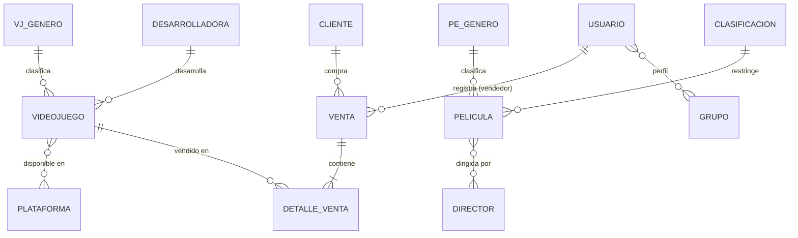

# ZonaOcio – Portal de entretenimiento (Django)

Proyecto de la asignatura **Programación Back End (TI3041)** – INACAP.

ZonaOcio es un sitio web que reúne un catálogo de **videojuegos** y una cartelera de **películas**,
e incorpora la **venta de videojuegos** con gestión de usuarios por perfil.

| Evaluación | Alcance |
|---|---|
| Sumativa N°1 | Sitio modular con 2 apps, datos en archivos JSON, Bootstrap local y herencia de plantillas. |
| Sumativa N°2 | Datos migrados a **MySQL** con Django ORM, variables de entorno y despliegue en **AWS EC2**. |
| Sumativa N°3 | **Sin Django Admin**: inicio de sesión, perfiles con permisos, dashboards por perfil, recuperación de contraseña por correo, mantenedores CRUD y transacción de venta. |

## Tecnologías

| Tecnología | Uso |
|---|---|
| Python 3 / Django 5.2 | Framework del lado del servidor |
| Sistema de autenticación de Django | Login, logout, grupos, permisos y recuperación de contraseña con token |
| MySQL / MariaDB + `mysqlclient` | Base de datos relacional (administrable con phpMyAdmin) |
| `python-dotenv` | Carga de configuraciones sensibles desde el archivo `.env` |
| SMTP (ej: Gmail) | Envío del correo de recuperación de contraseña |
| Gunicorn + Apache | Servidor de aplicación y servidor web en EC2 |
| WhiteNoise | Servir archivos estáticos |
| Bootstrap 5.3.3 (local) | Interfaz de usuario (`static/bootstrap/`) |

## Perfiles de usuario

Los perfiles son **grupos de Django** creados con `python manage.py crear_roles`.

| Perfil | Nivel | Puede |
|---|---|---|
| **Administrador** | Acceso total | Todos los mantenedores (crear, modificar, eliminar), todas las ventas (anular), **gestión de usuarios** y visualización global. |
| **Supervisor** | Intermedio | Ver, crear y modificar en todos los mantenedores (sin eliminar), registrar y anular ventas, ver todas las ventas e información operacional. |
| **Administrativo** | Mínimo | Consultar el catálogo, crear y modificar clientes y registrar **sus propias** ventas. Sin operaciones críticas (eliminar, anular, usuarios). |

Las vistas están protegidas con `login_required` y `permission_required`; los botones de cada
pantalla solo aparecen si el perfil tiene el permiso. Un acceso no permitido muestra **403 – Acceso denegado**.

## Funcionalidades

- **Inicio de sesión** con usuario y contraseña, **cierre de sesión** y **dashboard según el perfil**.
- **Recuperación de contraseña**: solicitud por correo → token seguro → enlace por email → validación →
  nueva contraseña → confirmación. El enlace vence en 1 hora y sirve una sola vez.
- **Gestión de usuarios** (Administrador): crear, buscar, modificar, desactivar, eliminar y asignar perfil.
- **Mantenedores CRUD** (crear, buscar, listar, modificar, eliminar) con formularios Django y validaciones:
  videojuegos, géneros, desarrolladoras, plataformas, películas, géneros de cine, directores,
  clasificaciones y clientes.
- **Transacción – Venta de videojuegos**: cliente + uno o más videojuegos. Valida stock y líneas repetidas,
  calcula subtotales y total, descuenta el stock en una transacción atómica y permite anular la venta
  (repone el stock).

## Modelo de datos



| App | Tabla | Finalidad | Relaciones |
|---|---|---|---|
| videojuegos | `videojuegos_genero` | Categorías de videojuegos | 1:N con videojuego |
| videojuegos | `videojuegos_desarrolladora` | Estudios desarrolladores | 1:N con videojuego |
| videojuegos | `videojuegos_plataforma` | Consolas / dispositivos | N:M con videojuego |
| videojuegos | `videojuegos_videojuego` | Catálogo de videojuegos (con stock) | FK `genero_id`, FK `desarrolladora_id` |
| videojuegos | `videojuegos_videojuego_plataformas` | Tabla intermedia N:M | FK `videojuego_id`, FK `plataforma_id` |
| peliculas | `peliculas_genero` | Géneros cinematográficos | 1:N con película |
| peliculas | `peliculas_clasificacion` | Clasificación por edad (TE, TE+7, 14, 18) | 1:N con película |
| peliculas | `peliculas_director` | Directores | N:M con película |
| peliculas | `peliculas_pelicula` | Cartelera de películas | FK `genero_id`, FK `clasificacion_id` |
| peliculas | `peliculas_pelicula_directores` | Tabla intermedia N:M | FK `pelicula_id`, FK `director_id` |
| ventas | `ventas_cliente` | Clientes (RUT validado) | 1:N con venta |
| ventas | `ventas_venta` | Cabecera de la venta (fecha, total) | FK `cliente_id`, FK `vendedor_id` (usuario) |
| ventas | `ventas_detalleventa` | Videojuegos vendidos en cada venta | FK `venta_id`, FK `videojuego_id` |
| auth | `auth_user`, `auth_group`, `auth_user_groups`, `auth_group_permissions` | Usuarios, perfiles y permisos | N:M usuario–grupo, grupo–permiso |

## Estructura del proyecto

```
Trabajo-Backend2026/
├── manage.py
├── requirements.txt
├── .env.example              # Plantilla de variables de entorno (.env no se sube)
├── zonaocio/                 # Proyecto principal
│   ├── settings.py
│   ├── urls.py
│   ├── crud.py               # Crear / modificar / eliminar genéricos con permisos
│   └── formularios.py        # Estilos Bootstrap y validaciones compartidas
├── templates/
│   ├── base.html             # Navbar (según sesión y perfil), mensajes, pie
│   ├── 403.html              # Acceso denegado
│   ├── crud/                 # Formulario y confirmación de eliminación
│   └── includes/             # Barra de acciones, botones y campos de formulario
├── static/                   # Bootstrap local, CSS e imágenes generales
├── videojuegos/              # App 1: catálogo de videojuegos + mantenedores
├── peliculas/                # App 2: cartelera de películas + mantenedores
├── cuentas/                  # Login, recuperación de contraseña, dashboards, usuarios y perfiles
│   ├── roles.py
│   ├── management/commands/crear_roles.py
│   └── templates/cuentas/    # login, recuperar/, panel_*.html, usuarios.html
├── ventas/                   # Clientes y transacción de venta
│   ├── models.py             # Cliente, Venta, DetalleVenta
│   ├── forms.py              # Validación de RUT, stock y líneas
│   └── servicios.py          # registrar_venta / anular_venta (transacción atómica)
├── deploy/                   # Servicio systemd (Gunicorn) y sitio de Apache
└── docs/                     # Documentos técnicos y guía de despliegue EC2
```

## Rutas principales

| URL | Acceso | Descripción |
|---|---|---|
| `/` · `/videojuegos/` · `/peliculas/` | Público | Inicio, catálogo y cartelera (consulta) |
| `/cuentas/login/` · `/cuentas/logout/` | Público | Iniciar y cerrar sesión |
| `/cuentas/recuperar/` | Público | Recuperación de contraseña por correo |
| `/cuentas/panel/` | Autenticado | Dashboard según el perfil |
| `/cuentas/usuarios/` | Administrador | Gestión de usuarios |
| `/<app>/<entidad>/agregar/`, `/<id>/modificar/`, `/<id>/eliminar/` | Según permisos | Mantenedores CRUD |
| `/ventas/` · `/ventas/nueva/` · `/ventas/<id>/` · `/ventas/<id>/anular/` | Según permisos | Transacción de venta |
| `/ventas/clientes/` | Según permisos | Mantenedor de clientes |

## Ejecución local

Requiere un servidor MySQL o MariaDB con una base de datos y un usuario creados.

```bash
git clone https://github.com/SirGabrielValdes/Trabajo-Backend2026.git
cd Trabajo-Backend2026
python -m venv venv
source venv/bin/activate            # Windows: venv\Scripts\activate
pip install -r requirements.txt

cp .env.example .env                # completar con los datos reales
python manage.py migrate
python manage.py importar_videojuegos
python manage.py importar_peliculas
python manage.py crear_roles
python manage.py createsuperuser
python manage.py runserver
```

Ingresar en <http://127.0.0.1:8000/cuentas/login/>. Sin `EMAIL_HOST` en el `.env`, el correo de
recuperación se muestra en la terminal.

## Despliegue en AWS EC2

Ver la guía completa en [`docs/GUIA_DESPLIEGUE_EC2.md`](docs/GUIA_DESPLIEGUE_EC2.md)
(sección 13 para actualizar una instancia que ya tenía la Evaluación N°2).

> Las imágenes de portada son ilustraciones SVG propias; los títulos y datos de videojuegos y
> películas son solo informativos.
